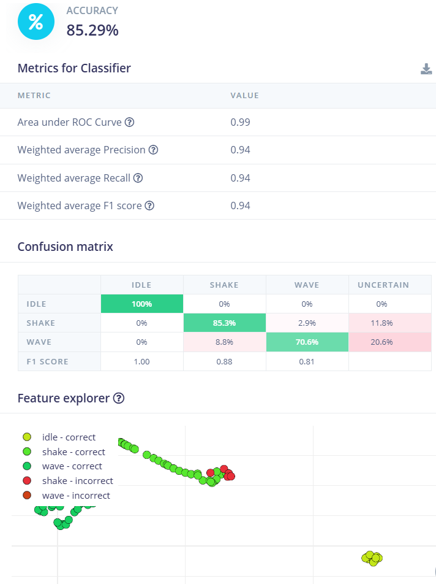
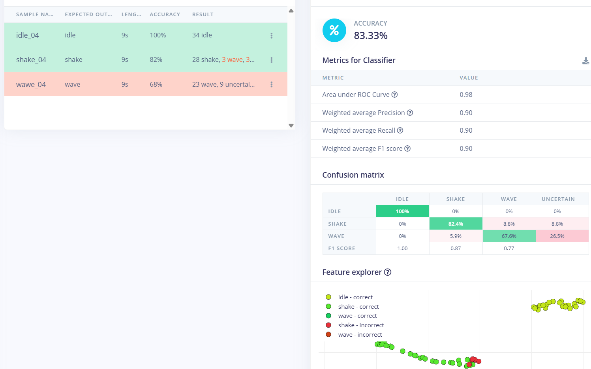

# Small gesture model

> Added slow wave data into the training stack of the model. Accuracy got worse on the Home Model, larger portion of data were labeled uncertain and also some to shake. Shake data was also affected by the retraining, but I can't explain it, since its data and test data were not changed.

## Class model

## Home model

